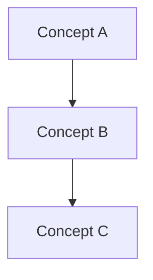

# <% tp.file.title %>

> **[[Status]]**: `Growing` | **Category**: Conceptual

---

## OVERVIEW
*Explain the core concept or architectural idea here.*

---

## DETAILED CONCEPT / ARCHITECTURE

### Key Principles
1. **Principle 1**: *Explanation*
2. **Principle 2**: *Explanation*

### Diagrams (Mermaid)

---

## RELATED TOPICS & NEXT STEPS
- *Links to other concepts or related [[Skill Notes]]*
