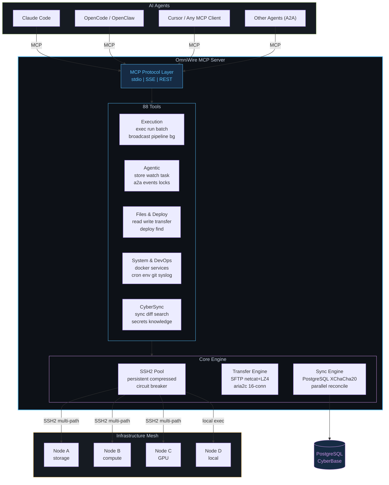

# [[OmniWire]] MCP Server

> [!info] MCP Server Profile
> **Type:** typescript
> **Framework:** @modelcontextprotocol/sdk
> **Source:** `C:/Users/Admin/Documents/GitHub/omniwire/src/mcp`
> **Repo:** https://github.com/omniwire/omniwire

## Description

34-tool universal AI agent interface (25 core + 9 CyberSync). SSH-exec, file transfer, realtime sync. Works with Claude Code, OpenCode, OpenClaw, any MCP client.

## Quick reference

| Field | Value |
|-------|-------|
| Type | typescript |
| Framework | @modelcontextprotocol/sdk |
| Source path | `C:/Users/Admin/Documents/GitHub/omniwire/src/mcp` |
| Repo | https://github.com/omniwire/omniwire |
| Tools detected | 34 |

## Tools exposed

- `omniwire_exec`
- `omniwire_broadcast`
- `omniwire_mesh_status`
- `omniwire_node_info`
- `omniwire_read_file`
- `omniwire_write_file`
- `omniwire_transfer_file`
- `omniwire_list_files`
- `omniwire_find_files`
- `omniwire_tail_log`
- `omniwire_process_list`
- `omniwire_disk_usage`
- `omniwire_install_package`
- `omniwire_service_control`
- `omniwire_docker`
- `omniwire_open_browser`
- `omniwire_port_forward`
- `omniwire_deploy`
- `omniwire`
- `cybersync_status`
- `cybersync_sync_now`
- `cybersync_diff`
- `cybersync_history`
- `cybersync_search_knowledge`
- `cybersync_get_memory`
- `cybersync_manifest`
- `cybersync_force_push`
- `omniwire_secrets`
- `cybersync_cookies`
- `omniwire_sync`
- `omniwire_sync_rules`
- `omniwire_sync_hooks`
- `omniwire_sync_memory`
- `omniwire_sync_agents`

## Source files

### `C:/Users/Admin/Documents/GitHub/omniwire/src/mcp/server.ts`

```typescript
// OmniWire MCP Server -- 34-tool universal AI agent interface (25 core + 9 CyberSync)
// Works with Claude Code, OpenCode, Oh-My-OpenAgent, OpenClaw, and any MCP client
//
// SECURITY NOTE: This file does NOT use child_process.exec(). All remote command
// execution goes through NodeManager.exec() which uses SSH2's client.exec() over
// authenticated, encrypted SSH channels. The "exec" references below are SSH2 methods.

import { McpServer } from '@modelcontextprotocol/sdk/server/mcp.js';
import { z } from 'zod';
import { readFileSync, writeFileSync, mkdirSync, existsSync, readdirSync } from 'node:fs';
import { join, dirname } from 'node:path';
import type { NodeManager } from '../nodes/manager.js';
import type { TransferEngine } from '../nodes/transfer.js';
import { ShellManager, kernelExec } from '../nodes/shell.js';
import { RealtimeChannel } from '../nodes/realtime.js';
import { TunnelManager } from '../nodes/tunnel.js';
import { openBrowser } from '../commands/browser.js';
import { describeEnvValue, formatEnvKeyListing, isValidEnvKey } from '../security/redaction.js';
import { allNodes, remoteNodes, findNode, NODE_ROLES, getDefaultNodeForTask, CONFIG } from '../protocol/config.js';
import { parseMeshPath } from '../protocol/paths.js';
import {
  genKeysCmd, parseKeys, buildWgConfig, wgConfigPath, bringUpCmd, bringDownCmd,
  statusCmd as meshStatusCmd, parseWgShow, addPeerCmd, removePeerCmd, installCmd,
  checkInstalledCmd, natTraversalPostUp, natTraversalPostDown, rotateKeyCmd,
  healthCheckCmd, stunDiscoverCmd, generateMeshTopology, detectOS,
} from '../mesh/omnimesh.js';

// -- Output helpers -- compact, scannable output for AI agents ----------------
type McpResult = { content: [{ type: 'text'; text: string }] };

const MAX_OUTPUT = 16000;

function t(ms: number): string {
  return ms < 1000 ? `${ms}ms` : `${(ms / 1000).toFixed(1)}s`;
}

function trim(s: string): string {
  if (s.length <= MAX_OUTPUT) return s;

  // Detect JSON — show item count on truncation
  if (s.trimStart().startsWith('[') || s.trimStart().startsWith('{')) {
    try {
      const parsed = JSON.parse(s);
      const count = Array.isArray(parsed) ? parsed.length : Object.keys(parsed).length;
      return s.slice(0, MAX_OUTPUT - 50) + `\n...(truncated, ${count} items total)`;
    } catch {}
  }

  // Detect table-like output — show header + tail
  const lines = s.split('\n');
  if (lines.length > 200) {
    const header = lines.slice(0, 5).join('\n');
    const lastLines = lines.slice(-10).join('\n');
    return header + '\n...\n' + lastLines + `\n(${lines.length} lines total)`;
  }

  return s.slice(0, MAX_OUTPUT) + '\n...(truncated)';
}

function ok(node: string, ms: number, body: string, label?: string): McpResult {
  const hdr = label ? `${node} > ${label}` : node;
  return { content: [{ type: 'text' as const, text: `${hdr}  ${t(ms)}\n${trim(body)}` }] };
}

function okBrief(msg: string): McpResult {
  return { content: [{ type: 'text' as const, text: msg }] };
}

function fail(msg: string): McpResult {
  return { content: [{ type: 'text' as const, text: `ERR ${msg}` }] };
}

interface ExecOutput { code: number; stdout: string; stderr: string; durationMs: number }

function fmtExecOutput(result: ExecOutput, timeoutSec: number): string {
  if (result.code === 0) return result.stdout || '(empty)';
  if (result.code === 124) return `TIMEOUT ${timeoutSec}s\n${result.stdout || '(empty)'}`;
  return `exit ${result.code}\n${result.stderr}`;
}

function fmtJson(node: string, result: ExecOutput, label?: string): McpResult {
  return okBrief(JSON.stringify({
    node, ok: result.code === 0, code: result.code, ms: result.durationMs,
    ...(label ? { label } : {}),
    stdout: result.stdout.slice(0, MAX_OUTPUT),
    ...(result.stderr ? { stderr: result.stderr.slice(0, 1000) } : {}),
  }));
}

function multiResult(results: { nodeId: string; code: number; stdout: string; stderr: string; durationMs: number }[]): McpResult {
  const parts = results.map((r) => {
    const mark = r.code === 0 ? 'ok' : `exit ${r.code}`;
    const body = r.code === 0
      ? (r.stdout || '(empty)').split('\n').slice(0, 30).join('\n')
      : r.stderr.split('\n').slice(0, 10).join('\n');
    return `-- ${r.nodeId}  ${t(r.durationMs)}  ${mark}\n${body}`;
  });
  return okBrief(trim(parts.join('\n\n')));
}

function multiResultJson(results: { nodeId: string; code: number; stdout: string; stderr: string; durationMs: number }[]): McpResult {
  return okBrief(JSON.stringify(results.map((r) => ({
    node: r.nodeId, ok: r.code === 0, code: r.code, ms: r.durationMs,
    stdout: r.stdout.slice(0, MAX_OUTPUT),
    ...(r.stderr ? { stderr: r.stderr.slice(0, 500) } : {}),
  }))));
}

// -- VPN namespace wrapper -- routes ONLY the command through VPN, mesh stays intact
// Uses Linux network namespaces: creates isolated netns, moves VPN tunnel into it,
// runs command inside namespace. Main namespace (WireGuard mesh, SSH) is untouched.
function buildVpnWrappedCmd(vpnSpec: string, innerCmd: string): string {
  const ns = `ow-vpn-${Date.now().toString(36)}`;
  const escaped = innerCmd.replace(/'/g, "'\\''");

  // Parse spec: "mullvad", "mullvad:se", "openvpn:/path/to.conf", "wg:wg-vpn"
  const [provider, param] = vpnSpec.includes(':') ? [vpnSpec.split(':')[0], vpnSpec.split(':').slice(1).join(':')] : [vpnSpec, ''];

  if (provider === 'mullvad') {
    // Mullvad supports split tunneling natively via `mullvad-exclude`
    // OR we can use its SOCKS5 proxy (10.64.0.1:1080) when connected
    // Best approach: use mullvad split-tunnel + namespace for full isolation
    const relayCmd = param ? `mullvad relay set location ${param} 2>/dev/null;` : '';
    // Check if mullvad is already connected; if not, connect (split-tunnel safe)
    return `${relayCmd} mullvad status | grep -q Connected || mullvad connect 2>/dev/null; sleep 1; ` +
      // Create netns, veth pair, route traffic through mullvad's tun
      `ip netns add ${ns} 2>/dev/null; ` +
      `ip link add veth-${ns} type veth peer name veth-${ns}-ns; ` +
      `ip link set veth-${ns}-ns netns ${ns}; ` +
      `ip addr add 172.30.${Math.floor(Math.random() * 254) + 1}.1/30 dev veth-${ns}; ` +
      `ip link set veth-${ns} up; ` +
      `ip netns exec ${ns} ip addr add 172.30.${Math.floor(Math.random() * 254) + 1}.2/30 dev veth-${ns}-ns; ` +
      `ip netns exec ${ns} ip link set veth-${ns}-ns up; ` +
      `ip netns exec ${ns} ip link set lo up; ` +
      // Use mullvad SOCKS proxy for the namespace (simpler, no route table manipulation)
      `ip netns exec ${ns} bash -c 'export ALL_PROXY=socks5://10.64.0.1:1080; ${escaped}'; ` +
      `_rc=$?; ip netns del ${ns} 2>/dev/null; ip link del veth-${ns} 2>/dev/null; exit $_rc`;
  }

  if (provider === 'openvpn') {
    const configPath = param || '/etc/openvpn/client.conf';
    // Run OpenVPN inside a network namespace — only the command sees the tunnel
    return `ip netns add ${ns} 2>/dev/null; ` +
      `ip netns exec ${ns} ip link set lo up; ` +
      `ip netns exec ${ns} openvpn --config "${configPath}" --daemon --log /tmp/${ns}.log --writepid /tmp/${ns}.pid; ` +
      `sleep 4; ` +  // wait for tunnel
      `ip netns exec ${ns} bash -c '${escaped}'; ` +
      `_rc=$?; kill $(cat /tmp/${ns}.pid 2>/dev/null) 2>/dev/null; ip netns del ${ns} 2>/dev/null; rm -f /tmp/${ns}.log /tmp/${ns}.pid; exit $_rc`;
  }

  if (provider === 'wg' || provider === 'wireguard') {
    const iface = param || 'wg-vpn';
    // Move WireGuard VPN interface into namespace — mesh wg0 stays in main ns
    return `ip netns add ${ns} 2>/dev/null; ` +
      `ip link add ${iface}-${ns} type wireguard; ` +
      `wg setconf ${iface}-${ns} /etc/wireguard/${iface}.conf 2>/dev/null; ` +
      `ip link set ${iface}-${ns} netns ${ns}; ` +
      `ip netns exec ${ns} ip link set lo up; ` +
      `ip netns exec ${ns} ip addr add 10.66.0.2/32 dev ${iface}-${ns}; ` +
      `ip netns exec ${ns} ip link set ${iface}-${ns} up; ` +
      `ip netns exec ${ns} ip route add default dev ${iface}-${ns}; ` +
      `ip netns exec ${ns} bash -c '${escaped}'; ` +
      `_rc=$?; ip netns del ${ns} 2>/dev/null; exit $_rc`;
  }

  // Fallback: just run the command (no VPN wrapping)
  return innerCmd;
}

// -- Command safety -- block patterns that could cause irreversible system damage
const BLOCKED_PATTERNS = [
  /rm\s+-rf\s+\/(?!\w)/,                   // rm -rf / (but allow rm -rf /tmp/something)
  /dd\s+if=\/dev\/zero.*of=\/dev\/sd/,      // dd zeroing disk
  /mkfs\./,                                 // format filesystem
  /:(){ :\|:& };:/,                         // fork bomb
  />\s*\/dev\/sd/,                          // redirect to disk device
  /chmod\s+-R\s+777\s+\//,                  // chmod 777 /
];

function checkCommandSafety(cmd: string): string | null {
  for (const pattern of BLOCKED_PATTERNS) {
    if (pattern.test(cmd)) return `Blocked dangerous pattern: ${pattern.source}`;
  }
  return null;
}

// -- Agentic state -- shared across tool calls in the same MCP session --------
// Session-scoped: all keys are cleared on process restart (not persisted to disk).
const resultStore = new Map<string, string>();  // key -> value store for chaining

// -- Audit log -- circular buffer of last 1000 exec events -------------------
interface AuditEntry { ts: number; tool: string; node: string; command: string; code: number; durationMs: number }
const auditLog: AuditEntry[] = [];

// -- Alias store -- in-memory command shortcuts ------------------------------
const aliasStore = new Map<string, string>();  // name -> command template

// -- Trace store -- distributed trace spans ---------------------------------
interface TraceSpan { node: string; command: string; startMs: number; endMs: number; result: string }
interface Trace { spans: TraceSpan[]; startMs: number; done: boolean }
const traceStore = new Map<string, Trace>();

// -- Background task registry -- dispatch-and-poll for any tool ---------------
interface BgTask { id: string; node: string; label: string; startedAt: number; promise: Promise<McpResult>; result?: McpResult }
const bgTasks = new Map<string, BgTask>();

function bgId(): string { return `bg-${Date.now().toString(36)}-${Math.random().toString(36).slice(2, 6)}`; }

function dispatchBg(node: string, label: string, fn: () => Promise<McpResult>): McpResult {
  const id = bgId();
  const task: BgTask = { id, node, label, startedAt: Date.now(), promise: fn() };
  task.promise.then((r) => { task.result = r; });
  bgTasks.set(id, task);
  return okBrief(`BACKGROUND ${id} dispatched on ${node}: ${label}`);
}
// -- CyberBase persistence layer -- fire-and-forget writes to PostgreSQL ------
// All tool data auto-persists to CyberBase without blocking responses.
// Uses the SSH connection to contabo (where PostgreSQL runs).
// Category-based key-value store in sync_items table.
let cbManager: NodeManager | null = null;
const CB_QUEUE: string[] = [];
let cbDraining = false;

function cbInit(mgr: NodeManager) { cbManager = mgr; }

/** psql helper — all DB calls have 5s statement_timeout to prevent hangs */
const pgExec = (sql: string) => `psql -h 127.0.0.1 -U cyberbase -d cyberbase -c "SET statement_timeout='5s'; ${sql}" 2>/dev/null`;

// CyberBase health tracking
let cbHealthy = true;
let cbFailCount = 0;
let cbLastError = '';
const CB_MAX_FAILS = 5;           // Circuit breaker: pause after N consecutive fails
const CB_RECOVERY_MS = 30_000;    // Try again after 30s
let cbRecoveryTimer: ReturnType<typeof setTimeout> | null = null;

function cbCircuitOpen(): boolean {
  if (cbFailCount >= CB_MAX_FAILS && cbHealthy) {
    cbHealthy = false;
    cbRecoveryTimer = setTimeout(() => { cbHealthy = true; cbFailCount = 0; }, CB_RECOVERY_MS);
    if (cbRecoveryTimer && 'unref' in cbRecoveryTimer) cbRecoveryTimer.unref();
  }
  return !cbHealthy;
}

function cbRecordSuccess(): void { cbFailCount = 0; cbHealthy = true; }
function cbRecordFail(err: string): void { cbFailCount++; cbLastError = err; }

/** Safely escape SQL values — defense in depth beyond '' escaping */
function sqlEscape(val: string): string {
  return val.replace(/'/g, "''").replace(/\\/g, '\\\\').replace(/\0/g, '');
}

/** Fire-and-forget write to CyberBase + Obsidian vault + Canvas. Never blocks, never throws. */
function cb(category: string, key: string, value: string) {
  // Sync to Obsidian vault + Canvas mindmap (local, synchronous, best-effort)
  // Skip auto-audit batch entries — they pollute vault/canvas with junk
  if (!key.startsWith('batch-')) syncVault(category, key, value);
  // Sync to CyberBase PostgreSQL (remote, async, queued)
  if (!cbManager || cbCircuitOpen()) return;
  const valEsc = sqlEscape(value).slice(0, 50000);
  const keyEsc = sqlEscape(`${category}:${key}`);
  const sql = `INSERT INTO knowledge (source_tool, key, value, updated_at) VALUES ('omniwire', '${keyEsc}', jsonb_build_object('data', '${valEsc}'), NOW()) ON CONFLICT (source_tool, key) DO UPDATE SET value = jsonb_build_object('data', '${valEsc}'), updated_at = NOW();`;
  CB_QUEUE.push(sql);
  if (!cbDraining) drainCb();
}

/** Batch-drain CyberBase write queue (max 10 per flush, retry on fail) */
async function drainCb() {
  if (!cbManager || CB_QUEUE.length === 0 || cbCircuitOpen()) { cbDraining = false; return; }
  cbDraining = true;
  const batch = CB_QUEUE.splice(0, 10);
  const combined = batch.join(' ');
  try {
    const r = await cbManager.exec('contabo', pgExec(combined));
    if (r.code === 0 || r.stdout.includes('INSERT') || r.stdout.includes('UPDATE')) {
      cbRecordSuccess();
    } else {
      cbRecordFail(r.stderr || 'unknown error');
      // Re-queue failed batch (once only, don't infinite loop)
      if (cbFailCount < CB_MAX_FAILS) CB_QUEUE.unshift(...batch);
    }
  } catch (e) {
    cbRecordFail((e as Error).message);
  }
  if (CB_QUEUE.length > 0 && !cbCircuitOpen()) setTimeout(drainCb, 100);
  else cbDraining = false;
}

// -- Obsidian + Canvas auto-sync ------------------------------------------------
// Mirrors CyberBase writes to local Obsidian vault + Canvas mindmap.
// Vault path resolved from env or default; if it doesn't exist, sync is silently skipped.
// Set OMNIWIRE_VAULT_ROOT to override, or OMNIWIRE_CANVAS_NAME for custom canvas filename.

const VAULT_ROOT = process.env.OMNIWIRE_VAULT_ROOT ?? join(
  process.env.USERPROFILE ?? process.env.HOME ?? '',
  'Documents', 'OmniWire'
);
const CANVAS_NAME = process.env.OMNIWIRE_CANVAS_NAME ?? 'OmniWire MindMap.canvas';
const CANVAS_PATH = join(VAULT_ROOT, CANVAS_NAME);
const vaultExists = existsSync(VAULT_ROOT);

/** Ensure the Obsidian vault root and canvas file exist, creating them if needed */
function ensureVault(): boolean {
  try {
    if (!existsSync(VAULT_ROOT)) mkdirSync(VAULT_ROOT, { recursive: true });
    if (!existsSync(CANVAS_PATH)) {
      // Create a default canvas with a central hub node
      const defaultCanvas = {
        nodes: [{
          id: 'core',
          type: 'text' as const,
    

... [truncated at 15,000 bytes; full source at C:/Users/Admin/Documents/GitHub/omniwire/src/mcp/server.ts]
```

### `C:/Users/Admin/Documents/GitHub/omniwire/src/mcp/index.ts`

```typescript
#!/usr/bin/env node

// OmniWire MCP Entrypoint — dual transport: stdio + SSE
// stdio: for Claude Code subprocess spawning
// SSE (port 3200): for OpenCode, Oh-My-OpenAgent, remote HTTP clients

import { StdioServerTransport } from '@modelcontextprotocol/sdk/server/stdio.js';
import { NodeManager } from '../nodes/manager.js';
import { TransferEngine } from '../nodes/transfer.js';
import { createOmniWireServer } from './server.js';
import { registerSyncTools } from './sync-tools.js';
import { startSSEServer } from './sse.js';
import { startRESTServer } from './rest.js';
import { SyncDB } from '../sync/db.js';
import { SyncEngine } from '../sync/engine.js';
import { getManifests } from '../sync/manifest.js';
import { allNodes } from '../protocol/config.js';
import { DEFAULT_SYNC_CONFIG } from '../sync/types.js';
import type { SyncConfig } from '../sync/types.js';
import { startEventServer, eventBus } from './events.js';

const args = process.argv.slice(2);
const useStdio = args.includes('--stdio');
const useJson = args.includes('--json');
const ssePort = parseInt(args.find((a) => a.startsWith('--sse-port='))?.split('=')[1] ?? '3200');
const restPort = parseInt(args.find((a) => a.startsWith('--rest-port='))?.split('=')[1] ?? '3201');
const eventPort = parseInt(args.find((a) => a.startsWith('--event-port='))?.split('=')[1] ?? '3202');
const bindAddr = args.find((a) => a.startsWith('--bind='))?.split('=')[1] ?? '127.0.0.1';
const noSync = args.includes('--no-sync');
const noEvents = args.includes('--no-events');

function log(msg: string, data?: Record<string, unknown>): void {
  if (useJson) {
    process.stderr.write(JSON.stringify({ msg, ...data }) + '\n');
  } else {
    process.stderr.write(msg + '\n');
  }
}

function detectNodeId(): string {
  if (process.platform === 'win32') return 'windows';
  const hostname = (process.env.HOSTNAME ?? '').toLowerCase();
  if (hostname.includes('contabo')) return 'contabo';
  if (hostname.includes('hostinger')) return 'hostinger';
  if (hostname.includes('thinkpad')) return 'thinkpad';
  return 'unknown';
}

async function main(): Promise<void> {
  const manager = new NodeManager();
  await manager.connectAll();

  const transfer = new TransferEngine(manager);
  const server = createOmniWireServer(manager, transfer);

  // Initialize CyberSync if not disabled
  let syncDb: SyncDB | null = null;
  if (!noSync) {
    try {
      const nodeId = detectNodeId();
      const config: SyncConfig = { ...DEFAULT_SYNC_CONFIG, nodeId };
      syncDb = new SyncDB(config);
      await syncDb.init();

      const node = allNodes().find((n) => n.id === nodeId);
      const os = node?.os ?? 'windows';
      const manifests = getManifests(os);
      const engine = new SyncEngine(syncDb, config, manager, transfer);

      registerSyncTools(server, syncDb, engine, manifests, nodeId, manager, transfer);
      log('CyberSync: 17 tools registered', { tools: 17, node: nodeId });
    } catch (err) {
      log(`CyberSync init failed (continuing without sync): ${(err as Error).message}`, { error: (err as Error).message });
    }
  }

  // Start auto-update background checker (non-blocking, unref'd timer)
  const noAutoUpdate = args.includes('--no-auto-update');
  if (!noAutoUpdate) {
    try {
      const { startAutoUpdate } = await import('../update.js');
      startAutoUpdate(3_600_000, (result) => {
        if (result.updated) log(`auto-updated: ${result.message}`, { autoUpdate: true, version: result.latestVersion });
      });
      log('auto-update: enabled (1h interval)');
    } catch { /* non-critical — continue without auto-update */ }
  }

  if (useStdio) {
    const transport = new StdioServerTransport();
    await server.connect(transport);
  } else {
    startSSEServer(server, ssePort, bindAddr);
    startRESTServer(manager, transfer, restPort, bindAddr);
    if (!noEvents) {
      startEventServer(eventPort, bindAddr);
      log(`Events: WS+SSE+Webhooks on ${bindAddr}:${eventPort}`, { eventPort });
    }
    log(`OmniWire MCP: SSE on ${bindAddr}:${ssePort}, REST on ${bindAddr}:${restPort}`, { ssePort, restPort });
  }

  process.on('SIGINT', async () => {
    if (syncDb) await syncDb.close();
    manager.disconnect();
    process.exit(0);
  });
}

main().catch((err) => {
  log(`Fatal: ${(err as Error).message}`, { fatal: true, error: (err as Error).message });
  process.exit(1);
});

```

### `C:/Users/Admin/Documents/GitHub/omniwire/src/mcp/events.ts`

```typescript
// OmniWire Events — Webhook + WebSocket + SSE event bus
// Unified event system for real-time notifications across all transports

import { createServer as createHttpServer, type IncomingMessage, type ServerResponse } from 'node:http';
import { WebSocketServer, WebSocket } from 'ws';
import { EventEmitter } from 'node:events';

// --- Types ---

export interface OmniWireEvent {
  readonly id: string;
  readonly type: OmniWireEventType;
  readonly timestamp: number;
  readonly source: string;      // node ID or 'system'
  readonly data: Record<string, unknown>;
}

export type OmniWireEventType =
  | 'exec.start' | 'exec.complete' | 'exec.error'
  | 'node.online' | 'node.offline' | 'node.health'
  | 'transfer.start' | 'transfer.complete' | 'transfer.error'
  | 'update.available' | 'update.applied'
  | 'mesh.peer-added' | 'mesh.peer-removed' | 'mesh.health'
  | 'sync.start' | 'sync.complete' | 'sync.conflict'
  | 'alert.fired' | 'alert.resolved'
  | 'firewall.blocked' | 'firewall.rule-changed'
  | 'vpn.connected' | 'vpn.disconnected'
  | 'store.set' | 'store.delete'
  | 'a2a.message' | 'a2a.task'
  | 'custom';

export interface WebhookConfig {
  readonly id: string;
  readonly url: string;
  readonly events: readonly OmniWireEventType[] | '*';  // '*' = all events
  readonly secret?: string;       // HMAC-SHA256 signing secret
  readonly headers?: Record<string, string>;
  readonly retries: number;       // Max retry attempts (default: 3)
  readonly timeoutMs: number;     // Request timeout (default: 5000)
  readonly active: boolean;
}

// --- Event Bus ---

class OmniWireEventBus extends EventEmitter {
  private sseClients: Set<ServerResponse> = new Set();
  private wsClients: Set<WebSocket> = new Set();
  private webhooks: Map<string, WebhookConfig> = new Map();
  private eventLog: OmniWireEvent[] = [];
  private maxLogSize = 1000;
  private eventCounter = 0;

  /** Emit an event to all transports */
  emit(type: string, ...args: unknown[]): boolean {
    return super.emit(type, ...args);
  }

  /** Publish an event to all connected clients (SSE, WS, webhooks) */
  publish(type: OmniWireEventType, source: string, data: Record<string, unknown> = {}): OmniWireEvent {
    const event: OmniWireEvent = {
      id: `evt-${Date.now()}-${++this.eventCounter}`,
      type,
      timestamp: Date.now(),
      source,
      data,
    };

    // Store in log (ring buffer)
    this.eventLog.push(event);
    if (this.eventLog.length > this.maxLogSize) {
      this.eventLog = this.eventLog.slice(-this.maxLogSize);
    }

    // Emit locally
    super.emit(type, event);
    super.emit('*', event);

    // Send to SSE clients
    this.broadcastSSE(event);

    // Send to WebSocket clients
    this.broadcastWS(event);

    // Send to webhooks (fire-and-forget)
    this.broadcastWebhooks(event);

    return event;
  }

  // --- SSE ---

  addSSEClient(res: ServerResponse, filter?: readonly OmniWireEventType[]): void {
    res.writeHead(200, {
      'Content-Type': 'text/event-stream',
      'Cache-Control': 'no-cache',
      'Connection': 'keep-alive',
      'Access-Control-Allow-Origin': '*',
    });

    // Send initial connection event
    const init: OmniWireEvent = {
      id: `evt-${Date.now()}-init`,
      type: 'custom',
      timestamp: Date.now(),
      source: 'system',
      data: { message: 'connected', filter: filter ?? '*' },
    };
    res.write(`data: ${JSON.stringify(init)}\n\n`);

    // Tag the response with filter for selective broadcasting
    (res as any).__omniwireFilter = filter;
    this.sseClients.add(res);

    res.on('close', () => this.sseClients.delete(res));
  }

  private broadcastSSE(event: OmniWireEvent): void {
    const payload = `id: ${event.id}\nevent: ${event.type}\ndata: ${JSON.stringify(event)}\n\n`;
    for (const client of this.sseClients) {
      const filter = (client as any).__omniwireFilter as readonly OmniWireEventType[] | undefined;
      if (!filter || filter.includes(event.type)) {
        try { client.write(payload); } catch { this.sseClients.delete(client); }
      }
    }
  }

  // --- WebSocket ---

  addWSClient(ws: WebSocket): void {
    this.wsClients.add(ws);
    ws.on('close', () => this.wsClients.delete(ws));
    ws.on('error', () => this.wsClients.delete(ws));

    // Handle incoming messages (subscriptions, commands)
    ws.on('message', (data) => {
      try {
        const msg = JSON.parse(data.toString());
        if (msg.type === 'subscribe') {
          (ws as any).__omniwireFilter = msg.events as OmniWireEventType[];
          ws.send(JSON.stringify({ type: 'subscribed', events: msg.events }));
        } else if (msg.type === 'ping') {
          ws.send(JSON.stringify({ type: 'pong', timestamp: Date.now() }));
        } else if (msg.type === 'replay') {
          // Replay recent events
          const count = Math.min(msg.count ?? 50, this.eventLog.length);
          const events = this.eventLog.slice(-count);
          ws.send(JSON.stringify({ type: 'replay', events }));
        }
      } catch { /* ignore malformed messages */ }
    });

    // Send connected event
    ws.send(JSON.stringify({ type: 'connected', timestamp: Date.now(), logSize: this.eventLog.length }));
  }

  private broadcastWS(event: OmniWireEvent): void {
    const payload = JSON.stringify(event);
    for (const ws of this.wsClients) {
      if (ws.readyState !== WebSocket.OPEN) { this.wsClients.delete(ws); continue; }
      const filter = (ws as any).__omniwireFilter as readonly OmniWireEventType[] | undefined;
      if (!filter || filter.includes(event.type)) {
        try { ws.send(payload); } catch { this.wsClients.delete(ws); }
      }
    }
  }

  // --- Webhooks ---

  addWebhook(config: WebhookConfig): void {
    this.webhooks.set(config.id, config);
  }

  removeWebhook(id: string): boolean {
    return this.webhooks.delete(id);
  }

  listWebhooks(): WebhookConfig[] {
    return [...this.webhooks.values()];
  }

  private async broadcastWebhooks(event: OmniWireEvent): Promise<void> {
    for (const webhook of this.webhooks.values()) {
      if (!webhook.active) continue;
      if (webhook.events !== '*' && !webhook.events.includes(event.type)) continue;
      // Fire-and-forget with retries
      void this.sendWebhook(webhook, event);
    }
  }

  private async sendWebhook(webhook: WebhookConfig, event: OmniWireEvent, attempt = 0): Promise<void> {
    try {
      const body = JSON.stringify(event);
      const headers: Record<string, string> = {
        'Content-Type': 'application/json',
        'X-OmniWire-Event': event.type,
        'X-OmniWire-Event-ID': event.id,
        'X-OmniWire-Timestamp': String(event.timestamp),
        ...webhook.headers,
      };

      // HMAC signature if secret is configured
      if (webhook.secret) {
        const { createHmac } = await import('node:crypto');
        const sig = createHmac('sha256', webhook.secret).update(body).digest('hex');
        headers['X-OmniWire-Signature'] = `sha256=${sig}`;
      }

      const controller = new AbortController();
      const timeout = setTimeout(() => controller.abort(), webhook.timeoutMs);

      const response = await fetch(webhook.url, {
        method: 'POST',
        headers,
        body,
        signal: controller.signal,
      });
      clearTimeout(timeout);

      if (!response.ok && attempt < webhook.retries) {
        // Exponential backoff: 1s, 2s, 4s
        await new Promise((r) => setTimeout(r, 1000 * Math.pow(2, attempt)));
        return this.sendWebhook(webhook, event, attempt + 1);
      }
    } catch {
      if (attempt < webhook.retries) {
        await new Promise((r) => setTimeout(r, 1000 * Math.pow(2, attempt)));
        return this.sendWebhook(webhook, event, attempt + 1);
      }
    }
  }

  // --- Query ---

  getRecentEvents(count = 50, filter?: OmniWireEventType): readonly OmniWireEvent[] {
    const events = filter ? this.eventLog.filter((e) => e.type === filter) : this.eventLog;
    return events.slice(-count);
  }

  getStats(): { sseClients: number; wsClients: number; webhooks: number; totalEvents: number; logSize: number } {
    return {
      sseClients: this.sseClients.size,
      wsClients: this.wsClients.size,
      webhooks: this.webhooks.size,
      totalEvents: this.eventCounter,
      logSize: this.eventLog.length,
    };
  }
}

// Singleton event bus
export const eventBus = new OmniWireEventBus();

// --- HTTP + WebSocket Server ---

export function startEventServer(port: number, bind = '127.0.0.1'): void {
  const httpServer = createHttpServer((req: IncomingMessage, res: ServerResponse) => {
    res.setHeader('Access-Control-Allow-Origin', '*');
    res.setHeader('Access-Control-Allow-Methods', 'GET, POST, DELETE, OPTIONS');
    res.setHeader('Access-Control-Allow-Headers', 'Content-Type');

    if (req.method === 'OPTIONS') { res.writeHead(204); res.end(); return; }

    const url = new URL(req.url ?? '/', `http://localhost:${port}`);

    // GET /events/stream — SSE stream
    if (req.method === 'GET' && url.pathname === '/events/stream') {
      const filterParam = url.searchParams.get('filter');
      const filter = filterParam ? filterParam.split(',') as OmniWireEventType[] : undefined;
      eventBus.addSSEClient(res, filter);
      return;
    }

    // GET /events/recent — recent events
    if (req.method === 'GET' && url.pathname === '/events/recent') {
      const count = parseInt(url.searchParams.get('count') ?? '50');
      const filter = url.searchParams.get('type') as OmniWireEventType | undefined;
      const events = eventBus.getRecentEvents(count, filter || undefined);
      res.writeHead(200, { 'Content-Type': 'application/json' });
      res.end(JSON.stringify({ events }));
      return;
    }

    // GET /events/stats — event bus stats
    if (req.method === 'GET' && url.pathname === '/events/stats') {
      res.writeHead(200, { 'Content-Type': 'application/json' });
      res.end(JSON.stringify(eventBus.getStats()));
      return;
    }

    // POST /events/publish — publish custom event
    if (req.method === 'POST' && url.pathname === '/events/publish') {
      let body = '';
      req.on('data', (chunk) => { body += chunk; });
      req.on('end', () => {
        try {
          const { type, source, data } = JSON.parse(body);
          const event = eventBus.publish(type ?? 'custom', source ?? 'api', data ?? {});
          res.writeHead(200, { 'Content-Type': 'application/json' });
          res.end(JSON.stringify(event));
        } catch {
          res.writeHead(400, { 'Content-Type': 'application/json' });
          res.end(JSON.stringify({ error: 'Invalid JSON' }));
        }
      });
      return;
    }

    // GET /webhooks — list webhooks
    if (req.method === 'GET' && url.pathname === '/webhooks') {
      res.writeHead(200, { 'Content-Type': 'application/json' });
      res.end(JSON.stringify({ webhooks: eventBus.listWebhooks() }));
      return;
    }

    // POST /webhooks — register webhook
    if (req.method === 'POST' && url.pathname === '/webhooks') {
      let body = '';
      req.on('data', (chunk) => { body += chunk; });
      req.on('end', () => {
        try {
          const config = JSON.parse(body) as Partial<WebhookConfig>;
          if (!config.url) {
            res.writeHead(400, { 'Content-Type': 'application/json' });
            res.end(JSON.stringify({ error: 'url required' }));
            return;
          }
          const webhook: WebhookConfig = {
            id: config.id ?? `wh-${Date.now()}`,
            url: config.url,
            events: config.events ?? '*',
            secret: config.secret,
            headers: config.headers,
            retries: config.retries ?? 3,
            timeoutMs: config.timeoutMs ?? 5000,
            active: config.active ?? true,
          };
          eventBus.addWebhook(webhook);
          res.writeHead(201, { 'Content-Type': 'application/json' });
          res.end(JSON.stringify(webhook));
        } catch {
          res.writeHead(400, { 'Content-Type': 'application/json' });
          res.end(JSON.stringify({ error: 'Invalid JSON' }));
        }
      });
      return;
    }

    // DELETE /webhooks/:id — remove webhook
    const whMatch = url.pathname.match(/^\/webhooks\/(.+)$/);
    if (req.method === 'DELETE' && whMatch) {
      const removed = eventBus.removeWebhook(whMatch[1]);
      res.writeHead(removed ? 200 : 404, { 'Content-Type': 'application/json' });
      res.end(JSON.stringify({ removed }));
      return;
    }

    res.writeHead(404, { 'Content-Type': 'application/json' });
    res.end(JSON.stringify({ error: 'Not found. Endpoints: /events/stream, /events/recent, /events/stats, /events/publish, /webhooks' }));
  });

  // WebSocket upgrade
  const wss = new WebSocketServer({ noServer: true });
  httpServer.on('upgrade', (req, socket, head) => {
    const url = new URL(req.url ?? '/', `http://localhost:${port}`);
    if (url.pathname === '/ws' || url.pathname === '/events/ws') {
      wss.handleUpgrade(req, socket, head, (ws) => {
        eventBus.addWSClient(ws);
      });
    } else {
      socket.destroy();
    }
  });

  httpServer.listen(port, bind);
}

```

### `C:/Users/Admin/Documents/GitHub/omniwire/src/mcp/rest.ts`

```typescript
// OmniWire REST API — simple HTTP API for non-MCP clients
// Port 3201 by default
// NOTE: Uses manager.exec() which is SSH2 client.exec(), not child_process

import { createServer, type IncomingMessage, type ServerResponse } from 'node:http';
import type { NodeManager } from '../nodes/manager.js';
import type { TransferEngine } from '../nodes/transfer.js';
import { allNodes, NODE_ROLES } from '../protocol/config.js';
import { parseMeshPath } from '../protocol/paths.js';

function readBody(req: IncomingMessage): Promise<string> {
  return new Promise((resolve) => {
    let body = '';
    req.on('data', (chunk) => { body += chunk; });
    req.on('end', () => resolve(body));
  });
}

function json(res: ServerResponse, status: number, data: unknown): void {
  res.writeHead(status, { 'Content-Type': 'application/json' });
  res.end(JSON.stringify(data));
}

export function startRESTServer(manager: NodeManager, transfer: TransferEngine, port: number, bind = '127.0.0.1'): void {
  const httpServer = createServer(async (req: IncomingMessage, res: ServerResponse) => {
    res.setHeader('Access-Control-Allow-Origin', 'http://localhost');
    res.setHeader('Access-Control-Allow-Methods', 'GET, POST, PUT, OPTIONS');
    res.setHeader('Access-Control-Allow-Headers', 'Content-Type');

    if (req.method === 'OPTIONS') { res.writeHead(204); res.end(); return; }

    const url = new URL(req.url ?? '/', `http://localhost:${port}`);
    const path = url.pathname;

    try {
      // GET /api/health
      if (req.method === 'GET' && path === '/api/health') {
        json(res, 200, { status: 'ok', online: manager.getOnlineNodes() });
        return;
      }

      // GET /api/nodes
      if (req.method === 'GET' && path === '/api/nodes') {
        const statuses = await manager.getAllStatus();
        const nodes = statuses.map((s) => ({
          ...s,
          role: NODE_ROLES[s.nodeId] ?? 'unknown',
          host: allNodes().find((n) => n.id === s.nodeId)?.host,
        }));
        json(res, 200, { nodes });
        return;
      }

      // GET /api/nodes/:id
      const nodeMatch = path.match(/^\/api\/nodes\/([^/]+)$/);
      if (req.method === 'GET' && nodeMatch) {
        const status = await manager.getNodeStatus(nodeMatch[1]);
        json(res, 200, { ...status, role: NODE_ROLES[nodeMatch[1]] ?? 'unknown' });
        return;
      }

      // POST /api/exec — { node, command } — runs command on remote node via SSH
      if (req.method === 'POST' && path === '/api/exec') {
        const body = JSON.parse(await readBody(req));
        if (typeof body.node !== 'string' || typeof body.command !== 'string') {
          json(res, 400, { error: 'Required: { node: string, command: string }' });
          return;
        }
        const result = await manager.exec(body.node, body.command);
        json(res, 200, result);
        return;
      }

      // POST /api/transfer — { src, dst }
      if (req.method === 'POST' && path === '/api/transfer') {
        const body = JSON.parse(await readBody(req));
        if (typeof body.src !== 'string' || typeof body.dst !== 'string') {
          json(res, 400, { error: 'Required: { src: string, dst: string }' });
          return;
        }
        const srcParsed = parseMeshPath(body.src);
        const dstParsed = parseMeshPath(body.dst);
        if (!srcParsed || !dstParsed) {
          json(res, 400, { error: 'Invalid path format. Use node:/path' });
          return;
        }
        const result = await transfer.transfer(
          srcParsed.nodeId, srcParsed.path,
          dstParsed.nodeId, dstParsed.path,
          body.mode ? { mode: body.mode } : undefined
        );
        json(res, 200, result);
        return;
      }

      // GET /api/nodes/:id/files/* — read file from node
      const fileReadMatch = path.match(/^\/api\/nodes\/([^/]+)\/files(\/.+)$/);
      if (req.method === 'GET' && fileReadMatch) {
        const content = await transfer.readFile(fileReadMatch[1], fileReadMatch[2]);
        res.writeHead(200, { 'Content-Type': 'text/plain' });
        res.end(content);
        return;
      }

      // PUT /api/nodes/:id/files/* — write file to node
      const fileWriteMatch = path.match(/^\/api\/nodes\/([^/]+)\/files(\/.+)$/);
      if (req.method === 'PUT' && fileWriteMatch) {
        const content = await readBody(req);
        await transfer.writeFile(fileWriteMatch[1], fileWriteMatch[2], content);
        json(res, 200, { written: true, path: fileWriteMatch[2], node: fileWriteMatch[1] });
        return;
      }

      json(res, 404, { error: 'Not found' });
    } catch (e) {
      json(res, 500, { error: (e as Error).message });
    }
  });

  httpServer.listen(port, bind);
}

```

### `C:/Users/Admin/Documents/GitHub/omniwire/src/mcp/sse.ts`

```typescript
// OmniWire SSE Transport — Server-Sent Events for remote MCP clients
// GET /sse — event stream for JSON-RPC responses
// POST /message — JSON-RPC requests

import { createServer, type IncomingMessage, type ServerResponse } from 'node:http';
import type { McpServer } from '@modelcontextprotocol/sdk/server/mcp.js';
import { SSEServerTransport } from '@modelcontextprotocol/sdk/server/sse.js';

export function startSSEServer(server: McpServer, port: number, bind = '127.0.0.1'): void {
  let transport: SSEServerTransport | null = null;

  const httpServer = createServer(async (req: IncomingMessage, res: ServerResponse) => {
    // CORS headers for browser-based MCP clients
    res.setHeader('Access-Control-Allow-Origin', '*');
    res.setHeader('Access-Control-Allow-Methods', 'GET, POST, OPTIONS');
    res.setHeader('Access-Control-Allow-Headers', 'Content-Type');

    if (req.method === 'OPTIONS') {
      res.writeHead(204);
      res.end();
      return;
    }

    if (req.method === 'GET' && req.url === '/sse') {
      transport = new SSEServerTransport('/message', res);
      await server.connect(transport);
      return;
    }

    if (req.method === 'POST' && req.url === '/message') {
      if (!transport) {
        res.writeHead(503, { 'Content-Type': 'application/json' });
        res.end(JSON.stringify({ error: 'No SSE connection active. Connect to /sse first.' }));
        return;
      }

      await transport.handlePostMessage(req, res);
      return;
    }

    // Health check
    if (req.method === 'GET' && req.url === '/health') {
      res.writeHead(200, { 'Content-Type': 'application/json' });
      res.end(JSON.stringify({ status: 'ok', transport: transport ? 'connected' : 'waiting' }));
      return;
    }

    res.writeHead(404, { 'Content-Type': 'application/json' });
    res.end(JSON.stringify({ error: 'Not found. Endpoints: GET /sse, POST /message, GET /health' }));
  });

  httpServer.listen(port, bind);
}

```

### `C:/Users/Admin/Documents/GitHub/omniwire/src/mcp/sync-tools.ts`

```typescript
// CyberSync — MCP tools for sync status, control, knowledge, and bi-directional sync

import { z } from 'zod';
import type { McpServer } from '@modelcontextprotocol/sdk/server/mcp.js';
import type { SyncDB } from '../sync/db.js';
import type { SyncEngine } from '../sync/engine.js';
import type { ToolManifest } from '../sync/types.js';
import { ALL_TOOLS } from '../sync/manifest.js';
import { SecretsManager } from '../sync/secrets.js';
import { CookieManager, parseCookies } from '../sync/cookies.js';
import type { CookieFormat } from '../sync/cookies.js';
import type { NodeManager } from '../nodes/manager.js';
import type { TransferEngine } from '../nodes/transfer.js';

export function registerSyncTools(
  server: McpServer,
  db: SyncDB,
  engine: SyncEngine,
  manifests: readonly ToolManifest[],
  nodeId: string,
  manager?: NodeManager,
  transfer?: TransferEngine,
): void {

  // --- Tool 23: cybersync_status ---
  server.tool(
    'cybersync_status',
    'CyberSync status: item counts, pending syncs, last heartbeat per node.',
    {},
    async () => {
      const heartbeats = await db.getHeartbeats();
      const counts = await db.getItemCounts();

      const lines: string[] = ['=== Node Heartbeats ==='];
      for (const hb of heartbeats) {
        lines.push(`${hb.nodeId}: last_seen=${hb.lastSeen.toISOString()}, items=${hb.itemsCount}, pending=${hb.pendingSync}`);
      }

      lines.push('', '=== Item Counts ===');
      for (const c of counts) {
        lines.push(`${c.tool}/${c.category}: ${c.count}`);
      }

      return { content: [{ type: 'text', text: lines.join('\n') }] };
    }
  );

  // --- Tool 24: cybersync_sync_now ---
  server.tool(
    'cybersync_sync_now',
    'Trigger immediate full reconciliation of all tool configs.',
    {},
    async () => {
      const result = await engine.reconcile(manifests);
      return {
        content: [{
          type: 'text',
          text: `Reconciliation complete: pushed=${result.pushed}, pulled=${result.pulled}, conflicts=${result.conflicts}`,
        }],
      };
    }
  );

  // --- Tool 25: cybersync_diff ---
  server.tool(
    'cybersync_diff',
    'Show items that differ between local node and the sync database.',
    {
      tool: z.string().optional().describe('Filter by tool name'),
    },
    async ({ tool }) => {
      const filteredManifests = tool
        ? manifests.filter((m) => m.tool === tool)
        : manifests;

      const diffs = await engine.getDiff(filteredManifests);

      if (diffs.length === 0) {
        return { content: [{ type: 'text', text: 'No differences found. All items in sync.' }] };
      }

      const lines = diffs.map((d) =>
        `[${d.direction}] ${d.tool}:${d.relPath} (local=${d.localHash?.slice(0, 8) ?? 'missing'}, remote=${d.remoteHash.slice(0, 8)})`
      );
      return { content: [{ type: 'text', text: `${diffs.length} differences:\n${lines.join('\n')}` }] };
    }
  );

  // --- Tool 26: cybersync_history ---
  server.tool(
    'cybersync_history',
    'Query sync event history.',
    {
      node: z.string().optional().describe('Filter by node'),
      event_type: z.string().optional().describe('Filter by event type (push, pull, conflict, delete, reconcile, error)'),
      limit: z.number().optional().describe('Max results (default 50)'),
    },
    async ({ node, event_type, limit }) => {
      const events = await db.getEvents({
        nodeId: node,
        eventType: event_type,
        limit: limit ?? 50,
      });

      if (events.length === 0) {
        return { content: [{ type: 'text', text: 'No events found.' }] };
      }

      const lines = events.map((e) =>
        `[${e.createdAt.toISOString()}] ${e.nodeId} ${e.eventType}: ${e.detail ?? ''}`
      );
      return { content: [{ type: 'text', text: lines.join('\n') }] };
    }
  );

  // --- Tool 27: cybersync_search_knowledge ---
  server.tool(
    'cybersync_search_knowledge',
    'Search the unified knowledge base across all AI tools and nodes.',
    {
      query: z.string().describe('Search query (matches key and value)'),
    },
    async ({ query }) => {
      const results = await db.searchKnowledge(query);

      if (results.length === 0) {
        return { content: [{ type: 'text', text: `No knowledge entries matching "${query}".` }] };
      }

      const lines = results.map((r) =>
        `[${r.sourceTool}] ${r.key}: ${JSON.stringify(r.value).slice(0, 200)}`
      );
      return { content: [{ type: 'text', text: `${results.length} results:\n${lines.join('\n')}` }] };
    }
  );

  // --- Tool 28: cybersync_get_memory ---
  server.tool(
    'cybersync_get_memory',
    'Get Claude memory entries from PostgreSQL (ingested from memory.db).',
    {
      node: z.string().optional().describe('Filter by node'),
      key: z.string().optional().describe('Search key pattern'),
    },
    async ({ node, key }) => {
      const entries = await db.getClaudeMemory({ nodeId: node, key });

      if (entries.length === 0) {
        return { content: [{ type: 'text', text: 'No memory entries found.' }] };
      }

      const lines = entries.map((e) =>
        `[${e.nodeId}] ${e.key}: ${e.value.slice(0, 300)}`
      );
      return { content: [{ type: 'text', text: `${entries.length} entries:\n${lines.join('\n')}` }] };
    }
  );

  // --- Tool 29: cybersync_manifest ---
  server.tool(
    'cybersync_manifest',
    'Show what files are tracked per AI tool.',
    {
      tool: z.string().optional().describe(`Tool name: ${ALL_TOOLS.join(', ')}`),
    },
    async ({ tool }) => {
      const filtered = tool
        ? manifests.filter((m) => m.tool === tool)
        : manifests;

      const lines: string[] = [];
      for (const m of filtered) {
        lines.push(`=== ${m.tool} ===`);
        lines.push(`Base: ${m.baseDir}`);
        lines.push(`Sync: ${m.syncGlobs.join(', ')}`);
        lines.push(`Exclude: ${m.excludeGlobs.join(', ') || '(none)'}`);
        if (m.ingestDb) lines.push(`Ingest DB: ${m.ingestDb}`);

        // Count items in DB
        const items = await db.getItemsByTool(m.tool);
        lines.push(`DB items: ${items.length}`);
        lines.push('');
      }

      return { content: [{ type: 'text', text: lines.join('\n') }] };
    }
  );

  // --- Tool 30: cybersync_force_push ---
  server.tool(
    'cybersync_force_push',
    'Force push a specific file to all online nodes, overwriting remote copies.',
    {
      tool: z.string().describe('Tool name'),
      rel_path: z.string().describe('Relative path within tool directory'),
    },
    async ({ tool, rel_path }) => {
      const manifest = manifests.find((m) => m.tool === tool);
      if (!manifest) {
        return { content: [{ type: 'text', text: `Unknown tool: ${tool}` }] };
      }

      const absPath = `${manifest.baseDir}/${rel_path}`;

      try {
        await engine.pushFile(tool, rel_path, absPath);
        return { content: [{ type: 'text', text: `Force pushed ${tool}:${rel_path} to all online nodes.` }] };
      } catch (err) {
        return { content: [{ type: 'text', text: `Error: ${(err as Error).message}` }] };
      }
    }
  );

  // --- Tool 31: omniwire_secrets ---
  server.tool(
    'omniwire_secrets',
    'Manage secrets across mesh nodes. Supports 1Password, file-based, and env backends.',
    {
      action: z.enum(['get', 'set', 'delete', 'list', 'sync', 'status']).describe('Action to perform'),
      key: z.string().optional().describe('Secret key (required for get/set/delete/sync)'),
      value: z.string().optional().describe('Secret value (required for set)'),
      nodes: z.array(z.string()).optional().describe('Target nodes for sync (all remote if omitted)'),
      backend: z.enum(['onepassword', 'file', 'env']).optional().describe('Override secrets backend'),
    },
    async ({ action, key, value, nodes: targetNodes, backend }) => {
      const secrets = new SecretsManager(backend ? { backend } : undefined);

      switch (action) {
        case 'status': {
          const opOk = await secrets.isOnePasswordAvailable();
          const items = await secrets.list();
          return { content: [{ type: 'text', text: `Backend: ${secrets.backend}\n1Password CLI: ${opOk ? 'available' : 'not found'}\nSecrets stored: ${items.length}` }] };
        }
        case 'list': {
          const items = await secrets.list();
          const text = items.length === 0
            ? 'No secrets stored'
            : items.map((i) => `  ${i.key} ${i.updatedAt ? `(${i.updatedAt})` : ''}`).join('\n');
          return { content: [{ type: 'text', text: `Secrets (${secrets.backend}):\n${text}` }] };
        }
        case 'get': {
          if (!key) return { content: [{ type: 'text', text: 'Error: key is required' }] };
          const val = await secrets.get(key);
          return { content: [{ type: 'text', text: val ? `${key} = ${val}` : `${key}: not found` }] };
        }
        case 'set': {
          if (!key || !value) return { content: [{ type: 'text', text: 'Error: key and value are required' }] };
          const ok = await secrets.set(key, value);
          return { content: [{ type: 'text', text: ok ? `Set ${key} (${secrets.backend})` : `Failed to set ${key}` }] };
        }
        case 'delete': {
          if (!key) return { content: [{ type: 'text', text: 'Error: key is required' }] };
          const ok = await secrets.delete(key);
          return { content: [{ type: 'text', text: ok ? `Deleted ${key}` : `Failed to delete ${key}` }] };
        }
        case 'sync': {
          if (!key) return { content: [{ type: 'text', text: 'Error: key is required for sync' }] };
          if (!manager) return { content: [{ type: 'text', text: 'Error: node manager not available' }] };
          const nodes = targetNodes ?? manager.getOnlineNodes().filter((id) => id !== nodeId);
          const results = await secrets.syncToNodes(key, nodes, manager);
          const text = Object.entries(results)
            .map(([n, ok]) => `  ${n}: ${ok ? 'OK' : 'FAILED'}`)
            .join('\n');
          return { content: [{ type: 'text', text: `Synced ${key} to nodes:\n${text}` }] };
        }
        default:
          return { content: [{ type: 'text', text: `Unknown action: ${action}` }] };
      }
    }
  );

  // --- Tool 35: cybersync_cookies ---
  server.tool(
    'cybersync_cookies',
    'Manage browser cookies across mesh nodes with CyberBase persistence. Store/retrieve/import/export in json/header/netscape format and sync to remote nodes via SSH.',
    {
      action: z.enum(['set', 'get', 'list', 'delete', 'import', 'export', 'sync']).describe('Action to perform'),
      domain: z.string().optional().describe('Cookie domain (required for set/get/delete/sync/export)'),
      cookies: z.string().optional().describe('Cookie data: JSON array for set, raw string for import'),
      format: z.enum(['json', 'header', 'netscape']).optional().describe('Cookie format (default: json)'),
      nodes: z.array(z.string()).optional().describe('Target node ids for sync (all online if omitted)'),
    },
    async ({ action, domain, cookies: cookieData, format, nodes: targetNodes }) => {
      const cookieMgr = new CookieManager(db, manager, transfer);
      const fmt = (format ?? 'json') as CookieFormat;
      switch (action) {
        case 'list': {
          const jars = await cookieMgr.list();
          if (jars.length === 0) {
            return { content: [{ type: 'text', text: 'No cookie jars stored.' }] };
          }
          const lines = jars.map((j) =>
            '  ' + j.domain + ': ' + j.count + ' cookies, updated=' + j.updatedAt + (j.source ? ', source=' + j.source : '')
          );
          return { content: [{ type: 'text', text: jars.length + ' cookie jar(s):\n' + lines.join('\n') }] };
        }
        case 'get': {
          if (!domain) return { content: [{ type: 'text', text: 'Error: domain is required for get' }] };
          const result = await cookieMgr.get(domain, fmt);
          if (!result) return { content: [{ type: 'text', text: 'No cookies found for ' + domain }] };
          return { content: [{ type: 'text', text: result }] };
        }
        case 'set': {
          if (!domain) return { content: [{ type: 'text', text: 'Error: domain is required for set' }] };
          if (!cookieData) return { content: [{ type: 'text', text: 'Error: cookies is required for set' }] };
          const parsed = parseCookies(cookieData, fmt, domain);
          await cookieMgr.set(domain, parsed);
          return { content: [{ type: 'text', text: 'Stored ' + parsed.length + ' cookie(s) for ' + domain }] };
        }
        case 'delete': {
          if (!domain) return { content: [{ type: 'text', text: 'Error: domain is required for delete' }] };
          await cookieMgr.delete(domain);
          return { content: [{ type: 'text', text: 'Deleted cookies for ' + domain }] };
        }
        case 'import': {
          if (!cookieData) return { content: [{ type: 'text', text: 'Error: cookies is required for import' }] };
          const results = await cookieMgr.import(cookieData, fmt, domain);
          const lines = Object.entries(results).map(([d, n]) => '  ' + d + ': ' + n + ' cookie(s)');
          return { content: [{ type: 'text', text: 'Imported cookies:\n' + lines.join('\n') }] };
        }
        case 'export': {
          if (!domain) return { content: [{ type: 'text', text: 'Error: domain is required for export' }] };
          const result = await cookieMgr.get(domain, fmt);
          if (!result) return { content: [{ type: 'text', text: 'No cookies found for ' + domain }] };
          return { content: [{ type: 'text', text: result }] };
        }
        case 'sync': {
          if (!manager) return { content: [{ type: 'text', text: 'Error: node manager not available' }] };
          if (domain) {
            const results = await cookieMgr.syncToNodes(domain, targetNodes);
            const lines = Object.entries(results).map(([n, ok]) => '  ' + n + ': ' + (ok ? 'OK' : 'FAILED'));
            return { content: [{ type: 'text', text: 'Synced ' + domain + ' to nodes:\n' + lines.join('\n') }] };
          } else {
            const allResults = await cookieMgr.syncAllToNodes(targetNodes);
            const lines = Object.entries(allResults).flatMap(([dom, nodeResults]) =>
              Object.entries(nodeResults).map(([n, ok]) => '  ' + dom + ' -> ' + n + ': ' + (ok ? 'OK' : 'FAILED'))
            );
            return { content: [{ type: 'text', text: lines.length ? lines.join('\n') : 'No cookie jars to sync.' }] };
          }
        }
        default:
          return { content: [{ type: 'text', text: 'Unknown action: ' + action }] };
      }
    }
  );

  // --- Tool: omniwire_sync ---
  server.tool(
    'omniwire_sync',
    'Bi-directional sync of rules, hooks, memory, agent configs, and settings across all mesh nodes. Syncs Claude Code, OpenClaw, and all AI tool configs.',
    {
      action: z.enum(['full', 'pus

... [truncated at 15,000 bytes; full source at C:/Users/Admin/Documents/GitHub/omniwire/src/mcp/sync-tools.ts]
```


## Original README

[](https://mseep.ai/app/voidchecksum-[[omniwire]])

<p align="center">
  <picture>
    <source media="(prefers-color-scheme: dark)" srcset="assets/banner-dark.svg" />
    <source media="(prefers-color-scheme: light)" srcset="assets/banner-light.svg" />
    
  </picture>
</p>

<p align="center">
  <a href="https://www.npmjs.com/package/[[omniwire]]"></a>
  
  
  
  
  <a href="LICENSE"></a>
  <a href="https://clawhub.ai/voidchecksum/[[omniwire]]"></a>
  <a href="https://docs.openclaw.ai/"></a>
</p>

<div align="center">

**The infrastructure layer for AI agent swarms.**

88 MCP tools · A2A protocol · OmniMesh VPN · nftables firewall · CDP browser · cookie sync · 2FA TOTP · bi-directional sync · CyberBase persistence

</div>

---

## Quick Start

```bash
npm install -g omniwire
```

Add to your AI agent (Claude Code, Cursor, OpenCode, etc.):

```json
{
  "mcpServers": {
    "omniwire": { "command": "omniwire", "args": ["--stdio"] }
  }
}
```

---

## Why [[OmniWire]]?

| Problem | [[OmniWire]] Solution |
|---------|-------------------|
| Managing multiple servers manually | One tool call controls any node |
| [[Agents]] can't coordinate with each other | A2A messaging, events, semaphores |
| Multi-step deploys need many round-trips | Pipelines chain steps in 1 call |
| Flaky commands break agent loops | Built-in retry + assert + watch |
| Long tasks block the agent | `background: true` on any tool |
| Results lost between tool calls | Session store with `{{key}}` interpolation |
| Different transfer methods for diff sizes | Auto-selects SFTP / netcat+LZ4 / aria2c |
| SSH connections drop | Multi-path failover + circuit breaker |

---

## Use Cases

<table>
<tr>
<td width="50%">

### DevOps & Infrastructure
```bash
# Deploy to all nodes in one call
omniwire_deploy(src="node-a:/app/v2.tar.gz", dst="/opt/app/")

# Rolling service restart
omniwire_batch([
  {node: "node1", command: "systemctl restart app"},
  {node: "node2", command: "systemctl restart app"}
], parallel=false)

# Monitor disk across fleet
omniwire_disk_usage()
```

</td>
<td width="50%">

### Security & Pentesting
```bash
# Anonymous nmap through Mullvad VPN
omniwire_exec(
  node="node-a",
  command="nmap -sV -T4 target.com",
  via_vpn="mullvad:se",
  background=true
)

# Rotate exit IP between scans
omniwire_vpn(action="rotate", node="node-a")

# Run nuclei through VPN namespace
omniwire_exec(command="nuclei -u target.com",
  via_vpn="mullvad", store_as="nuclei_results")
```

</td>
</tr>
<tr>
<td>

### Multi-Agent Coordination
```bash
# Agent A dispatches work
omniwire_task_queue(action="enqueue",
  queue="recon", task="subfinder -d target.com")

# Agent B picks it up
omniwire_task_queue(action="dequeue", queue="recon")

# Share findings on blackboard
omniwire_blackboard(action="post",
  topic="subdomains", data="api.target.com")

# A2A messaging between agents
omniwire_a2a_message(action="send",
  channel="results", message="scan complete")
```

</td>
<td>

### Background & Async [[[[[[[[[[[[[[[[[[[[[[[[[[[[[[[[[[[[[[[[[[[[[[[[[[[[[[[[[[[[[[[[[[[[[[[[[[[[[[[[[[[[[[[[[[[[[[[[[[[[[[[[[[[[[[[[[[[[[[[[[[[[[[[[[[[[[[[[[[[[[[[[[[[[[[[[[[[[[[[[[[[[[[[[[[[[[[[[[[[[[[[[[[[[[[[[[[[[[[[[[[[[[[[[[[[[[[[[[[[[[[[[[[[[[[[[[[[[[[[[[[[[[[[[[[[[[[[[[[[[[[[[[[[[[[[[[[[[[[[[[[[[[[[[[[[[[[[[[[[[[[[[[[[[[[[[[[[[[[[[[[[[[[[[[[[[[[[[[[[[[[[[[[[[[[[[[[[[[[[[[[[[[[[[[[[[[[[[[[[[[[[[[[[[[[[[[[[[[[[[[[[[[[[[[[[[[[[[[[[[[[[[[[[[[[[[[[[[[[[[[[[[[[[[[[[[[[[[[[[[[[[[[[[[[[[[[[[[[[[[[[[[[[[[[[[[[[[[[[[[[[[[[[[[[[[[[[[[[[[[[[[[[[[[[[[[[[[[[[[[[[[[[[[[[[[[[[[[[[[[[[[[[[[[[[[[[[[[Workflows]]]]]]]]]]]]]]]]]]]]]]]]]]]]]]]]]]]]]]]]]]]]]]]]]]]]]]]]]]]]]]]]]]]]]]]]]]]]]]]]]]]]]]]]]]]]]]]]]]]]]]]]]]]]]]]]]]]]]]]]]]]]]]]]]]]]]]]]]]]]]]]]]]]]]]]]]]]]]]]]]]]]]]]]]]]]]]]]]]]]]]]]]]]]]]]]]]]]]]]]]]]]]]]]]]]]]]]]]]]]]]]]]]]]]]]]]]]]]]]]]]]]]]]]]]]]]]]]]]]]]]]]]]]]]]]]]]]]]]]]]]]]]]]]]]]]]]]]]]]]]]]]]]]]]]]]]]]]]]]]]]]]]]]]]]]]]]]]]]]]]]]]]]]]]]]]]]]]]]]]]]]]]]]]]]]]]]]]]]]]]]]]]]]]]]]]]]]]]]]]]]]]]]]]]]]]]]]]]]]]]]]]]]]]]]]]]]]]]]]]]]]]]]]]]]]]]]]]]]]]]]]]]]]]]]]]]]]]]]]]]]]]]]]]]]]]]]]]]]]]]]]]]]]]]]]]]]]]]]]]]]]]]]]]]]]]]]]]]]]]]]]]]]]]]]]]]]]]]]]]]]]]]]]]]]]]]]]]
```bash
# Long build in background
omniwire_exec(
  command="docker build -t app .",
  node="node-a", background=true
)
# Returns: "BACKGROUND bg-abc123"

# Check progress
omniwire_bg(action="poll", task_id="bg-abc123")
# Returns: "RUNNING (45.2s)"

# Get result when done
omniwire_bg(action="result", task_id="bg-abc123")

# Pipeline: build -> test -> deploy
omniwire_pipeline(steps=[
  {node: "node-a", command: "make build"},
  {node: "node-a", command: "make test"},
  {command: "deploy.sh", store_as: "version"}
])
```

</td>
</tr>
<tr>
<td>

### File Operations
```bash
# Transfer large dataset between nodes
omniwire_transfer_file(
  src="node-a:/data/model.bin",
  dst="hostinger:/ml/model.bin"
)
# Auto-selects: aria2c (16-conn parallel)

# Sync config to all nodes
omniwire_deploy(
  src_node="node-a",
  src_path="/etc/nginx/nginx.conf",
  dst_path="/etc/nginx/nginx.conf"
)
```

</td>
<td>

### VPN & Anonymous Operations
```bash
# Full Mullvad setup for a node
omniwire_vpn(action="connect", server="se",
  node="node-a")
omniwire_vpn(action="quantum", config="on")
omniwire_vpn(action="daita", config="on")
omniwire_vpn(action="multihop", config="se:us")
omniwire_vpn(action="dns", config="adblock")
omniwire_vpn(action="killswitch", config="on")

# Verify anonymous IP
omniwire_vpn(action="ip", node="node-a")

# Node-wide VPN (mesh stays connected)
omniwire_vpn(action="full-on", server="de")
```

</td>
</tr>
</table>

---

## Architecture



---

## Agent [[Setup]] Instructions

### OpenClaw

[[OmniWire]] is available as a [ClawHub skill](https://clawhub.ai/voidchecksum/omniwire):

```bash
# Install via ClawHub CLI
clawhub install omniwire

# Or manual: copy integrations/openclaw/SKILL.md to your OpenClaw skills directory
cp integrations/openclaw/SKILL.md ~/.openclaw/skills/omniwire.md
```

CyberSync automatically ingests OpenClaw [[agents]], [[skills]], memory, and workspace into CyberBase PostgreSQL.

### [[PaperClip]]

Register [[OmniWire]] as a zero-cost infrastructure agent:

```json
{
  "agents": [{
    "name": "omniwire",
    "type": "local-cli",
    "command": "omniwire --stdio",
    "skills": ["mesh-exec", "file-transfer", "service-control", "docker", "vpn", "scraping", "firewall"],
    "budget": { "monthly_usd": 0 }
  }]
}
```

See `integrations/[[paperclip]]/` for the full adapter and [[[[[[[[[[[[[[[[[[[[[[[[[[[[[[[[[[[[[[[[[[[[[[[[[[[[[[[[[[[[[[[[[[[[[[[[[[[[[[[[[[[[[[[[[[[[[[[[[[[[[[[[[[[[[[skill]]]]]]]]]]]]]]]]]]]]]]]]]]]]]]]]]]]]]]]]]]]]]]]]]]]]]]]]]]]]]]]]]]]]]]]]]]]]]]]]]]]]]]]]]]]]]]]]]]]]]]]]]]]]]] definition.

### Claude Code

```json
{
  "mcpServers": {
    "omniwire": {
      "command": "omniwire",
      "args": ["--stdio"]
    }
  }
}
```

### OpenCode / Oh-My-OpenAgent

```json
{
  "mcp": {
    "omniwire": {
      "type": "local",
      "command": ["omniwire", "--stdio"]
    }
  }
}
```

### Codex / Gemini

CyberSync automatically syncs [[OmniWire]] config to Codex and Gemini environments.

---

## Key Capabilities

<table>
<tr>
<td width="50%">

### Execution
```
omniwire_exec       single command + retry + assert
omniwire_run        multi-line script (compact UI)
omniwire_batch      N commands, 1 tool call, chaining
omniwire_broadcast  parallel across all nodes
omniwire_pipeline   multi-step DAG with data flow
omniwire_bg         poll/list background tasks
```

</td>
<td width="50%">

### Multi-Agent (A2A)
```
omniwire_store        session key-value store
omniwire_a2a_message  agent-to-agent queues
omniwire_event        pub/sub event bus
omniwire_semaphore    distributed locking
omniwire_agent_task   async background dispatch
omniwire_workflow     reusable named DAGs
```

</td>
</tr>
<tr>
<td>

### Adaptive File Transfer
```
 < 10 MB   SFTP         native, 80ms
 10M-1GB   netcat+LZ4   compressed, 100ms
 > 1 GB    aria2c       16-parallel, max speed
```

</td>
<td>

### Connection Resilience
```
Connected --> Health Ping (30s, parallel)
    |
Failure --> Multi-path Failover
    |         WireGuard -> Tailscale -> Public IP
    |
    +--> Retry (300ms -> 600ms -> ... -> 10s)
    |
3 fails --> Circuit OPEN (15s) -> Auto-recover
```

</td>
</tr>
<tr>
<td>

### Background Dispatch
```
# Any tool supports background: true
exec(background=true)   -> "bg-abc123"
bg(action="poll", id=..) -> "RUNNING (3.2s)"
bg(action="result", id=..) -> full output
bg(action="list")       -> all tasks + status
```

</td>
<td>

### Agentic Chaining
```
exec(store_as="ip")       store result
exec(command="ping {{ip}}") interpolate
batch(abort_on_fail=true)   fail-fast
exec(format="json")         structured output
exec(retry=3, assert="ok")  resilient
watch(assert="ready")       poll until
```

</td>
</tr>
</table>

---

## All 88 Tools

> **Every tool** supports `background: true` — returns a task ID immediately. Poll with `omniwire_bg`.

<details>
<summary><b>Execution (6)</b></summary>

| Tool | Description |
|------|-------------|
| `omniwire_exec` | Run command on any node. `retry`, `assert`, `store_as`, `format:"json"`, `{{key}}`, `via_vpn`. |
| `omniwire_run` | Multi-line scripts via temp file. |
| `omniwire_batch` | N commands in 1 call. Chaining `{{prev}}`, `abort_on_fail`, parallel/sequential. |
| `omniwire_broadcast` | Execute on all nodes simultaneously. |
| `omniwire_pipeline` | Multi-step DAG with `{{prev}}`/`{{stepN}}` interpolation. |
| `omniwire_bg` | List/poll/retrieve background task results. |

</details>

<details>
<summary><b>Agentic / A2A (12)</b></summary>

| Tool | Description |
|------|-------------|
| `omniwire_store` | Session key-value store for cross-call chaining. |
| `omniwire_watch` | Poll until assert matches — deploys, builds, readiness. |
| `omniwire_healthcheck` | Parallel health probe all nodes (disk, mem, load, docker). |
| `omniwire_agent_task` | Background task dispatch with poll/retrieve. |
| `omniwire_a2a_message` | Agent-to-agent message queues (send/receive/peek). |
| `omniwire_semaphore` | Distributed locking — atomic acquire/release. |
| `omniwire_event` | Pub/sub events per topic. |
| `omniwire_workflow` | Reusable named workflow DAGs. |
| `omniwire_agent_registry` | Agent capability discovery + heartbeat. |
| `omniwire_blackboard` | Shared blackboard for swarm coordination. |
| `omniwire_task_queue` | Distributed priority queue — enqueue/dequeue/complete. |
| `omniwire_capability` | Query node capabilities for intelligent routing. |

</details>

<details>
<summary><b>Files & Transfer (6)</b></summary>

| Tool | Description |
|------|-------------|
| `omniwire_read_file` | Read file from any node (`node:/path`). |
| `omniwire_write_file` | Write/create file on any node. |
| `omniwire_list_files` | List directory contents. |
| `omniwire_find_files` | Glob search across nodes. |
| `omniwire_transfer_file` | Copy between nodes (auto SFTP/netcat/aria2c). |
| `omniwire_deploy` | Deploy one file to all nodes in parallel. |

</details>

<details>
<summary><b>Monitoring (3)</b></summary>

| Tool | Description |
|------|-------------|
| `omniwire_mesh_status` | Health, latency, CPU/mem/disk — all nodes. |
| `omniwire_node_info` | Detailed info for one node. |
| `omniwire_live_monitor` | Snapshot metrics: cpu, memory, disk, network. |

</details>

<details>
<summary><b>System & DevOps (12)</b></summary>

| Tool | Description |
|------|-------------|
| `omniwire_process_list` | List/filter processes across nodes. |
| `omniwire_disk_usage` | Disk usage for all nodes. |
| `omniwire_tail_log` | Last N lines of a log file. |
| `omniwire_install_package` | Install via apt/npm/pip. |
| `omniwire_service_control` | systemd start/stop/restart/[[status]]. |
| `omniwire_docker` | Docker commands on any node. |
| `omniwire_kernel` | dmesg, sysctl, modprobe, lsmod, strace, perf. |
| `omniwire_cron` | List/add/remove cron jobs. |
| `omniwire_env` | Get/set persistent environment variables. |
| `omniwire_network` | ping, traceroute, dns, ports, speed, connections. |
| `omniwire_git` | Git commands on repos on any node. |
| `omniwire_syslog` | Query journalctl with filters. |

</details>

<details>
<summary><b>Network, VPN & Security (9)</b></summary>

| Tool | Description |
|------|-------------|
| `omniwire_firewall` | nftables engine — presets, rate-limit, geo-block, port-knock, ban/unban. Mesh whitelisted. |
| `omniwire_vpn` | Mullvad/OpenVPN/WireGuard/Tailscale — multi-hop, DAITA, quantum, killswitch. Mesh-safe. |
| `omniwire_cookies` | Cookie management — JSON/Header/Netscape, browser extract, CyberBase + 1Password sync. |
| `omniwire_cdp` | Chrome DevTools Protocol — headless Chrome, screenshot, PDF, DOM, cookies. |
| `omniwire_proxy` | HTTP/SOCKS proxy management on any node. |
| `omniwire_dns` | DNS resolve, set server, flush cache, block domains. |
| `omniwire_port_forward` | SSH tunnels — create/list/close/mesh-expose. |
| `omniwire_shell` | Persistent PTY session (preserves cwd/env). |
| `omniwire_clipboard` | Shared clipboard buffer across mesh. |

</details>

<details>
<summary><b>Infrastructure (9)</b></summary>

| Tool | Description |
|------|-------------|
| `omniwire_backup` | Snapshot/restore paths. Diff, cleanup, retention. |
| `omniwire_container` | Docker lifecycle — compose, build, push, logs, prune, stats. |
| `omniwire_cert` | TLS certs — Let's Encrypt, check expiry, self-signed. |
| `omniwire_user` | User & SSH key management, sudo config. |
| `omniwire_schedule` | Distributed cron with failover. |
| `omniwire_alert` | Threshold alerting — disk/mem/load/offline + webhook notify. |
| `omniwire_log_aggregate` | Cross-node log search in parallel. |
| `omniwire_benchmark` | CPU/memory/disk/network benchmarks. |
| `omniwire_stream` | Capture streaming output (tail -f, watch). |

</details>

<details>
<summary><b>OmniMesh & Events (6)</b></summary>

| Tool | Description |
|------|-------------|
| `omniwire_omnimesh` | WireGuard mesh manager — [[init]]/up/down/add-peer/sync-peers/health/rotate-keys/topology. All OS. |
| `omniwire_mesh_expose` | Expose localhost services to mesh — discover/expose/unexpose/expose-remote. |
| `omniwire_mesh_gateway` | Auto-expose all localhost services mesh-wide. |
| `omniwire_events` | Webhook + WebSocket + SSE [[[[event]]]] bus. Publish, manage webhooks, query log. |
| `omniwire_knowledge` | CyberBase knowledge CRUD, text/semantic search, health, vacuum, bulk-set, export. |
| `omniwire_update` | Self-[[update]] from npm + GitHub. Auto-[[update]], mesh-wide push. |

</details>

<details>
<summary><b>Agent Toolkit (7)</b></summary>

| Tool | Description |
|------|-------------|
| `omniwire_snippet` | Reusable command templates with `{{var}}` substitution. |
| `omniwire_alias` | In-session command shortcuts. |
| `omniwire_trace` | Distributed tracing — span waterfalls across nodes. |
| `omniwire_doctor` | Health diagnostics — SSH, disk, mem, docker, WireGuard, CyberBase. |
| `omniwire_metrics` | Prometheus-compatible metrics scrape/export. |
| `omniwire_audit` | Command audit log — view/search/stats. |
| `omniwire_plugin` | Plugin system — list/load from `~/.[[omniwire]]/plugins/`. |

</details>

<details>
<summary><b>CyberSync (9)</b></summary>

| Tool | Description |
|------|-------------|
| `cybersync_status` | Sync [[status]], item counts, pending syncs. |
| `cybersync_sync_now` | Trigger immediate reconciliation. |
| `cybersync_diff` | Local vs database differences. |
| `cybersync_history` | Sync [[[[event]]]] log. |
| `cybersync_search_knowledge` | Full-text search unified knowledge base. |
| `cybersync_get_memory` | Retrieve Claude memory from PostgreSQL. |
| `cybersync_manifest` | Tracked files per tool. |
| `cybersync_force_push` | Force push file to all nodes. |
| `omniwire_secrets` | Secrets management (1Password, file, env). |

</details>

---

## Performance

| Operation | Latency | Optimization |
|-----------|---------|-------------|
| **Command exec** | **~80ms** | AES-128-GCM cipher, persistent SSH2, zero-fork `:` ping |
| **Mesh [[status]]** | **~100ms** | Parallel probes, 5s cache, single `/proc` read |
| **File read (<1MB)** | **~60ms** | SFTP-first (skips `cat` fork) |
| **Transfer (10MB)** | **~120ms** | LZ4 compression (10x faster than gzip) |
| **Transfer (1GB)** | **~8s** | aria2c 16-connection parallel |
| **Pipeline (5 steps)** | **~400ms** | `{{prev}}` interpolation, no extra tool calls |
| **Health check (all)** | **~90ms** | Parallel Promise.allSettled |
| **A2A message** | **~85ms** | File-append queue, atomic dequeue |
| **Reconnect** | **~300ms** | 300ms initial, 2s keepalive, 15s circuit breaker |

<details>
<summary><b>Optimization details</b></summary>

- **Cipher**: AES-128-GCM (AES-NI hardware accelerated)
- **Key exchange**: curve25519-sha256 (fastest modern KEX)
- **Keepalive**: 2s interval, 2 retries = 4s dead detection
- **Port finder**: `shuf` (pure bash) replaces `python3 -c socket` (-30ms)
- **Compression**: LZ4-1 for transfers (10x faster than gzip)
- **Buffer**: Array push + join (O(n) vs O(n^2) string concat)
- **[[Status]]**: Single `/proc` read replaces multiple piped commands
- **Health ping**: `:` builtin (no hash lookup, no fork)
- **Reads**: SFTP tried first, `cat` fallback only on failure
- **Circuit breaker**: 15s recovery, 10s reconnect cap

</details>

---

## Security

- All remote execution via `ssh2.Client.exec()` -- never `child_process.exec()`
- Key-based auth only, no passwords stored, SSH key caching
- Multi-path failover: WireGuard -> Tailscale -> Public IP
- Secret-bearing tool output is redacted by default (`omniwire_env` lists keys, not values)
- Prefer 1Password or another managed vault for production secrets; file/env backends are local-development fallbacks
- 2MB output guard prevents memory exhaustion
- 4KB auto-truncation prevents context window bloat
- Circuit breaker isolates failing nodes
- CORS restricted to localhost on REST API

---

## Transport Modes

| Mode | Port | Use Case |
|------|------|----------|
| `--stdio` | -- | Claude Code, Cursor, MCP subprocess |
| `--sse-port=N` | 3200 | OpenCode, remote HTTP MCP clients |
| `--rest-port=N` | 3201 | Scripts, dashboards, non-MCP |

```bash
omniwire --stdio                          # MCP mode (default)
omniwire --sse-port=3200 --rest-port=3201 # HTTP mode
omniwire --stdio --no-sync               # MCP without CyberSync
omniwire    # or: ow                      # Interactive REPL
```

---

## Configure Mesh

Create `~/.[[omniwire]]/mesh.json`:

```json
{
  "nodes": [
    { "id": "server1", "host": "10.0.0.1", "user": "root", "identityFile": "id_ed25519", "role": "storage" },
    { "id": "server2", "host": "10.0.0.2", "user": "root", "identityFile": "id_ed25519", "role": "compute" }
  ]
}
```

---

## Agentic Installation / [[Setup]]

> For adding a new node to your [[OmniWire]] mesh — what to have ready, how to wire it in, and how to connect it to Claude Code.

### Prerequisites

| Requirement | Notes |
|-------------|-------|
| **Node.js >= 20** | `node -v` to verify |
| **npm >= 9** | Comes with Node.js 20+ |
| **WireGuard** | `wg` CLI + kernel module (Linux: `apt install wireguard`, macOS: Homebrew, Windows: GUI installer) |
| **SSH key pair** | Ed25519 recommended — `ssh-keygen -t ed25519 -f ~/.ssh/id_omniwire` |
| **SSH access to nodes** | Key deployed to `~/.ssh/authorized_keys` on every remote node |
| **1Password CLI** | `op` v2+, signed in — required for `omniwire_secrets` and cookie sync to vault |
| **PostgreSQL (optional)** | Required only for CyberSync / CyberBase persistence — Node A hosts it (configure CYBERSYNC_DB_URL accordingly) |

### Install [[OmniWire]]

```bash
npm install -g omniwire
omniwire --version   # verify
```

### Add a New Node

**1. Generate WireGuard keypair on the new node:**
```bash
wg genkey | tee /etc/wireguard/node_private.key | wg pubkey > /etc/wireguard/node_pub.key
cat /etc/wireguard/node_pub.key
```

**2. Assign it a mesh IP** (next available in `10.0.0.0/24`):

| Node | Mesh IP | Role |
|------|---------|------|
| Node A (hub) | `10.0.0.1` | storage, CyberBase |
| Hostinger | `10.0.0.2` | compute |
| Windows PC | `10.0.0.3` | local dev |
| ThinkPad | `10.0.0.4` | local dev |
| _new node_ | `10.0.0.N` | assign next |

**3. Register the node with OmniMesh** (run from any node already in the mesh):
```bash
omniwire_omnimesh(action="add-peer",
  id="newnode",
  public_key="<pubkey from step 1>",
  allowed_ips="10.0.0.N/32",
  endpoint="<public IP or DNS>:51820"
)
```

**4. Push updated peer list to all nodes:**
```bash
omniwire_omnimesh(action="sync-peers")
```

**5. Bring the interface up on the new node:**
```bash
wg-quick up wg0
ping 10.0.0.1   # verify hub reachability
```

### Configure [[OmniWire]] on the New Node

Add the node to `~/.[[omniwire]]/mesh.json` (create if absent):

```json
{
  "nodes": [
    { "id": "node-a",   "host": "10.0.0.1", "user": "root", "identityFile": "~/.ssh/id_omniwire", "role": "storage" },
    { "id": "hostinger", "host": "10.0.0.2", "user": "root", "identityFile": "~/.ssh/id_omniwire", "role": "compute" },
    { "id": "windows",   "host": "10.0.0.3", "user": "Admin", "identityFile": "~/.ssh/id_omniwire", "role": "local" },
    { "id": "thinkpad",  "host": "10.0.0.4", "user": "user",  "identityFile": "~/.ssh/id_omniwire", "role": "local" }
  ]
}
```

Verify connectivity:
```bash
omniwire_mesh_status    # should show all nodes green
omniwire_doctor         # checks SSH, disk, mem, WireGuard, CyberBase
```

### Connect Claude Code via MCP

Add to `~/.claude/claude_desktop_config.json` (or your IDE's MCP config):

```json
{
  "mcpServers": {
    "omniwire": { "command": "omniwire", "args": ["--stdio"] }
  }
}
```

Restart Claude Code. Verify in a new session:
```
omniwire_mesh_status()   # 88 tools should be available
```

### Environment Variables

| Variable | Required | Description |
|----------|----------|-------------|
| `OP_SERVICE_ACCOUNT_TOKEN` | For 1Password sync | Service account token from 1Password |
| `OMNIWIRE_VAULT_ROOT` | Optional | Path to Obsidian vault root (default: CyberBase vault) |
| `CYBERSYNC_DB_URL` | Optional | PostgreSQL DSN — defaults to `postgresql://cyberbase@10.0.0.1:5432/cyberbase` |
| `OMNIWIRE_MESH_CONFIG` | Optional | Override mesh.json path |

Set persistently on a node. Values are written to `/etc/environment`, but tool responses only confirm whether a value is set and never echo the secret back:
```bash
omniwire_env(action="set", key="OP_SERVICE_ACCOUNT_TOKEN", value="<token>", node="node-a")
omniwire_env(action="get", key="OP_SERVICE_ACCOUNT_TOKEN", node="node-a")  # OP_SERVICE_ACCOUNT_TOKEN=<redacted: set>
```

### CyberSync Auto-Distribution

CyberSync pushes configs, secrets, and memories to all nodes automatically via PostgreSQL.

```bash
# Check what's tracked
omniwire_coc(action="cybersync-status")

# Force push current config to all nodes
omniwire_coc(action="force-sync")

# Diff local state vs database
cybersync_diff()
```

On first run, CyberSync pulls node configs, 2

... [truncated at 25,000 bytes; full source at C:/Users/Admin/Documents/GitHub/[[omniwire]]/[[[[[[[[[[[[[[[[[[[[[[[[[[[[[[[[[[[[[[[[[[[[[[[[[[[[[[[[[[[[[[[[[[README]]]]]]]]]]]]]]]]]]]]]]]]]]]]]]]]]]]]]]]]]]]]]]]]]]]]]]]]]]]]]]]]]].md]


## See also

- [[10.12 MCP]] — sector index
- [[pentest-ai-mcp]]
- [[ponytail-mcp]]
- [[supermemory-mcp]]
- [[mcp-code-executor]]
- [[read-file-enhanced-mcp]]
